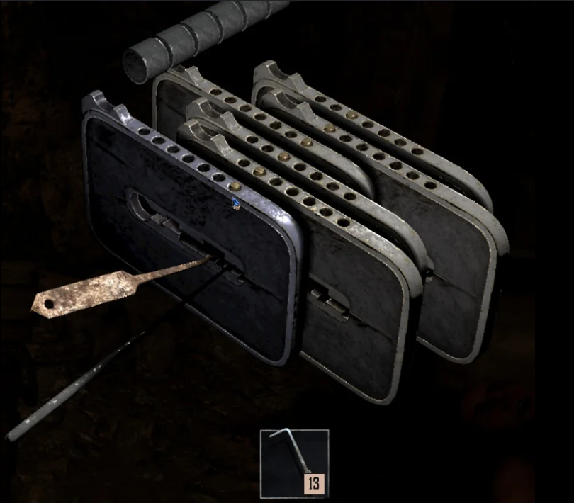
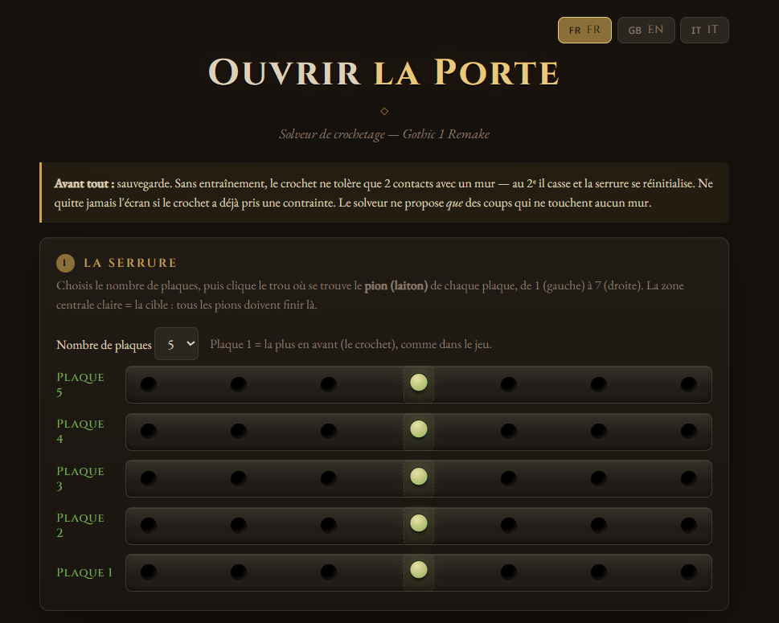
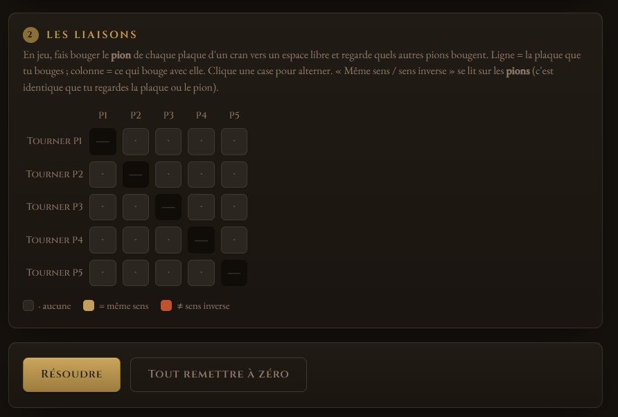

import BrowserWindow from '../../components/mockups/BrowserWindow.astro';

Outil web · gratuit et open source

# Gothic 1 Remake : Lockpick Solver

Un outil gratuit et open source pour ne plus jamais casser un crochet dans la Colonie.

## Essayez-le ici

L'outil tourne directement dans la fenêtre ci-dessous : c'est la vraie application, pas une capture.

<BrowserWindow title="okamilang.github.io/gothic1-lockpick-solver">
  <iframe
    class="live-demo"
    src="https://okamilang.github.io/gothic1-lockpick-solver/"
    title="Gothic 1 Remake : Lockpick Solver (démo interactive)"
    loading="lazy"
  ></iframe>
</BrowserWindow>

La démo ne s'affiche pas ? Utilisez « Accéder au programme » en haut de page.

## À propos de cet outil

Dans le remake de Gothic 1, le crochetage demande de la précision et de la mémoire pour trouver la bonne séquence (gauche/droite). Cet outil calcule et mémorise cette séquence à votre place, sans sacrifier vos précieux crochets.

## Fonctionnalités

- **Suivi de la séquence :** l'outil mémorise vos entrées et déduit les mouvements restants.
- **Moins de casse :** l'algorithme choisit le chemin le plus court qui préserve vos crochets.
- **Pensé pour jouer :** utilisable en surimpression, sur un second écran ou sur téléphone.

## Mode d'emploi

1. **Saisissez la serrure.** Choisissez le nombre de plaques, puis, pour chaque plaque, cliquez sur le trou où se trouve son pion, de 1 (gauche) à 7 (droite). Le centre (trou 4) est la cible.
2. **Renseignez les liaisons.** En jeu, poussez le pion de chaque plaque d'un cran et observez quels autres pions bougent. Reportez-le dans la grille : · aucune, = même sens, ≠ sens inverse.
3. **Lancez la résolution.** Cliquez sur Résoudre : l'outil calcule la séquence la plus courte qui n'écrase jamais un pion contre un mur.
4. **Reproduisez coup par coup.** Avancez avec Suivant et refaites chaque mouvement en jeu. Si un coup est impossible, une position ou une liaison saisie est fausse : corrigez-la et relancez.

## En jeu

<figure class="shot">

<figcaption>La serrure telle qu'elle apparaît dans le jeu : c'est elle que l'outil résout.</figcaption>
</figure>

Captures de l'outil (si la démo ne s'affiche pas)

<figure class="shot">

<figcaption>Capture : saisie des plaques et des liaisons.</figcaption>
</figure>

<figure class="shot">

<figcaption>Capture : la séquence calculée, coup par coup.</figcaption>
</figure>

