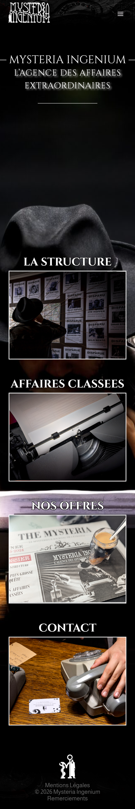

import MobileDevice from '../../components/mockups/MobileDevice.astro';

## Le défi : sur-mesure et autonomie

Mysteria Ingenium voulait une vitrine immersive, très esthétique et interactive, tout en restant **autonome** pour faire vivre ses contenus. J'ai donc gardé **WordPress** comme outil d'édition, mais en sortant complètement de ses thèmes.

## Exécution technique

Des blocs et une logique d'affichage écrits en **JavaScript** et **CSS sur-mesure** ont été greffés sur WordPress. Résultat : une ambiance de film noir (animations, lumière, interactions) que le client peut modifier lui-même, textes et images compris, depuis son tableau de bord.

<MobileDevice target="win-mobile-mysteria-ingenium">

</MobileDevice>

La même atmosphère, adaptée au téléphone.

